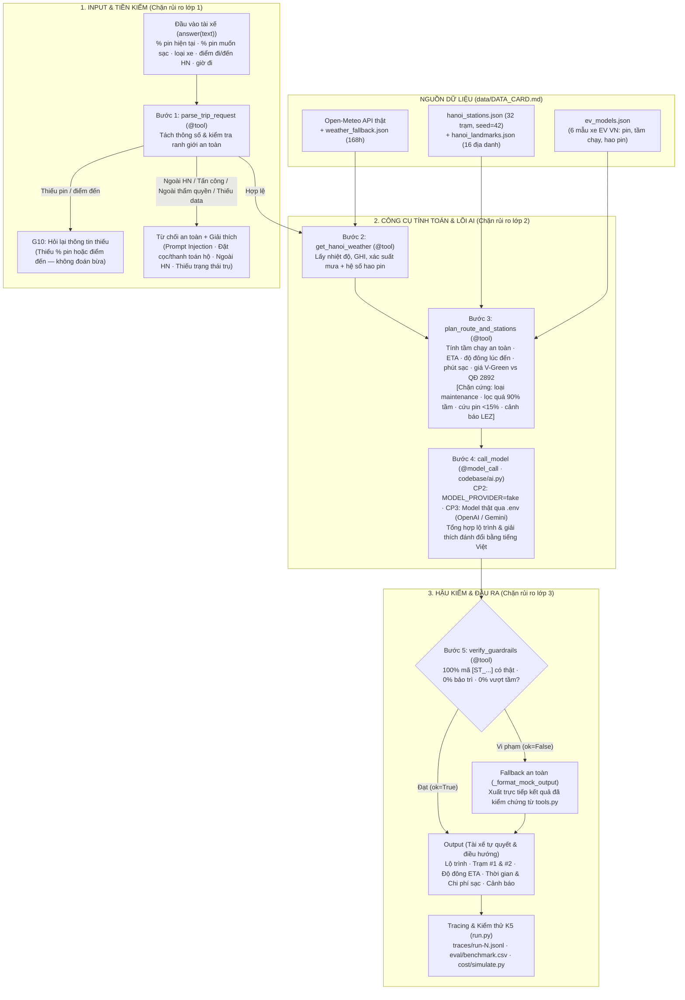

# AI SPEC — CHARGEPILOT · Nhóm NhungAnhChang3Chan · Lớp L3B · Track C

> Mốc nộp: §7 chốt chuẩn "đạt" tại **CP2 19:30 Thứ Sáu 27/11** · §0–§7 nộp **CP3 10:00 Thứ Bảy 28/11** · đủ §0–§10 **CP4 14:30 Thứ Bảy 28/11** · §10 changelog ghi tiếp đến **23:59 Thứ Bảy 28/11**.
> Đầu mỗi mục ghi bước guide (`02-guide.md` trong repo đề) chỉ cách điền. Mỗi mục ngắn, có số và nguồn; chi tiết để ở file được trỏ tới. Xoá dòng hướng dẫn trong ngoặc vuông khi điền xong.

Track: [ ] A · [ ] B · [ ] C · [ ] D · [ ] E — bài toán: [đề gợi ý trong file track, hoặc bài toán nhóm tự mở rộng] __
Data BTC cấp đã dùng (nếu có — không commit nguyên file): __

## §0. Hiện tại việc này diễn ra thế nào *(guide 1.1)*
- Luồng hiện tại của việc này, trong khoá hoặc trên app thật (3–5 bước; ảnh chụp từ tài khoản của mình, đã che thông tin):
- Công cụ / AI đang được dùng cho việc này (nếu có) + nguồn. Không kiểm được thì ghi "chưa kiểm":

## §1. Người dùng & bằng chứng *(guide 1.1, 1.2)*
- Người dùng chính (một vai cụ thể): tài xế ô tô điện đi du lịch tự lái hoặc chở khách theo lịch trình tại Hà Nội (giữ theo canvas dòng 2). Người đi xe máy điện (Evo200) là người dùng phụ, chỉ được phục vụ ở mức gợi ý điểm sạc có trong dữ liệu.
- Việc họ cố làm xong (`động từ + đối tượng + bối cảnh`, không có chữ AI):
- Hôm nay họ giải bằng gì, hỏng ở đâu, vì sao chưa bỏ:
- Pain (KHÔNG chữ AI): ai — đang làm gì — vướng đâu — hậu quả gì:
- Bằng chứng — số chính + kết luận (chi tiết: `evidence/summary.md`): khảo sát Google Form 27/11/2026 ([kết quả](https://docs.google.com/spreadsheets/d/1snnt7ZLwUSfAMaQSgS3vNXEuUuPBQWm-cn7rXv51xls/edit?gid=914628555#gid=914628555)), 39 câu trả lời, bỏ 3 người chưa từng đi xe điện → n = 36. Trong 1 tháng qua: 15/36 gặp trạm quá đông giờ cao điểm 17:30–22:30, 15/36 bị rét / nóng / tắc đường làm tụt pin, 13/36 không ước lượng được thời gian sạc, 13/36 app báo trống nhưng tới nơi kín chỗ, 11/36 gặp trụ hỏng / bảo trì; 13/36 mất thêm ≥ 20 phút ở lần gần nhất.
  - **Lệch đối tượng:** khảo sát chủ yếu tới người đi xe máy điện (31/39 người dùng xe máy điện, chỉ 8/39 chỉ đi ô tô), trong khi người dùng chính của lát cắt là tài xế ô tô điện. Các số trên vì vậy là bằng chứng pain của người đi xe điện nói chung, **chưa phải** của riêng tài xế ô tô đi du lịch; cần phỏng vấn thêm tài xế ô tô để kiểm lại trước CP3.
  - Thận trọng: 17/39 người chưa từng tự tìm trạm công cộng (chỉ sạc ở nhà), trong đó 11 người vẫn chọn sự cố gặp phải.

## §2. Impact & quyết định chọn *(guide 1.3)*

| Hướng | Bao nhiêu người gặp | Bao nhiêu lần / tháng | Mỗi lần tốn gì | Impact / tháng | Làm kịp không | Chọn? |
|---|---|---|---|---|---|---|
|  |  |  |  |  |  |  |
|  |  |  |  |  |  |  |
|  |  |  |  |  |  |  |

- **Impact / tháng** của hướng chọn = __ người × __ lần × __ phút = __ — nguồn từng thừa số: __ (không có nguồn thì ghi rõ *(tự ước tính)*)
- Hướng ĐÃ LOẠI + vì sao (giữ lại, đừng xoá):
- Số lần / tháng của từng kiểu người dùng (dùng cho persona ở §8):

## §3. Giải pháp tương tự *(guide 2.1)*
- [sản phẩm / tính năng gần giống]: một điều đáng học · một điều đáng né · mình khác gì

## §4. Thiết kế *(guide 2.2, 3.2)*
- **Lát cắt MỘT CÂU** (1 người dùng · 1 việc · 1 quyết định AI · 1 kết quả):
- Không làm (≥3 điều):
- **Sơ đồ** (ảnh / Mermaid / draw.io): [chèn ở đây]
- **Hình dạng:** [ ] workflow cố định · [ ] một agent · [ ] nhiều agent — 2 dòng lý do, và vì sao **không** chọn hình dạng phức tạp hơn:
- **Lát cắt MỘT CÂU:** Tài xế xe điện đi du lịch/di chuyển tại Hà Nội nhập `% pin hiện tại`, `% pin muốn sạc`, `loại xe` và `điểm đến trong Hà Nội` → tìm lộ trình đi và điểm sạc phù hợp nhất → AI kết hợp thời tiết thực tế Hà Nội (Open-Meteo), trạng thái trụ, ước tính độ đông tại đúng giờ xe tới trạm (ETA), cảnh báo LEZ Hoàn Kiếm và chi phí (V-Green đồng giá vs QĐ 2892) để đề xuất lộ trình + trạm tối ưu kèm chốt chặn an toàn → tránh trạm bảo trì/quá đông, tính đúng thời gian sạc tới mức pin mong muốn và không bị cạn pin giữa đường.
- **Không làm (≥3 điều):**
  1. Không tự động đặt cọc, giữ trụ hay thanh toán hộ qua ví người dùng.
  2. Không xây dựng hệ thống dự báo phụ tải LSTM hay học tăng cường PPO/MARL trong 10 giờ hackathon.
  3. Không hỗ trợ tuyến liên tỉnh ngoài phạm vi TP. Hà Nội (chưa có dữ liệu trạm ngoài Hà Nội).
  4. Không chạy nhiều LLM Agent phản biện vòng lặp phức tạp gây chậm và đội chi phí gấp 3 lần.
- **Sơ đồ kiến trúc (Workflow cố định 4 bước + 3 lớp Chặn rủi ro · khớp `codebase/agent.py`, `tools.py`, `ai.py` & `DATA_CARD.md`):**

- **Hình dạng:** `[x] workflow cố định` · `[ ] một agent` · `[ ] nhiều agent` — **Lý do:** Quy trình tư vấn lộ trình sạc có các bước tuần tự cố định (tách thông số → lấy thời tiết → tính toán toán học lộ trình/ETA/độ đông → AI tổng hợp giải thích → hậu kiểm). Chọn workflow cố định giúp chi phí token thấp nhất, độ trễ nhanh, và loại bỏ lỗi tính toán khoảng cách/tiền điện của LLM; không chọn nhiều agent vì chỉ có 1 vai tư vấn duy nhất, tách nhiều agent sẽ nhân 3 độ trễ và token.
- **AI dựa vào đâu** — mỗi công cụ (khớp `codebase/tools.py`):

  | Công cụ | Input | Output | Tác động ra ngoài? |
  |---|---|---|---|
  |  |  |  |  |

- **Mức tự động:** [ ] AI gợi ý, người quyết · [ ] AI tự làm khi chắc, chuyển người khi không · [ ] AI tự làm — lý do (sai thì ai chịu gì, sửa đắt hay rẻ):
- **Chỗ chặn rủi ro** (rủi ro lớn nhất của lát cắt bị chặn ở đâu, bằng gì):
- **Chỗ người duyệt** (việc AI không được tự làm):
- **Nguyên tắc thiết kế** (≥3, bắt buộc G10):

  | Nguyên tắc | Chỗ cụ thể trên sơ đồ / trong bản chạy thử |
  |---|---|
  | G10 — thu hẹp phạm vi khi không chắc |  |
  |  |  |
  |  |  |

- Phần nào còn giả (công cụ trả dữ liệu giả, model chế độ giả…) — ghi rõ, không giả làm thật:

## §5. Chỗ khó — 4 lớp + ≥6 kịch bản + 2 tấn công *(guide 2.3)*

| Kịch bản | Lớp (1–4) | Hành vi mong muốn (nói gì, hiện gì, cho làm gì tiếp) | Câu thử |
|---|---|---|---|
|  |  |  |  |
| *(tấn công)* |  |  |  |
| *(tấn công)* |  |  |  |

(1) nguồn sự thật · (2) mơ hồ / thiếu thông tin · (3) ngoài phạm vi / thẩm quyền · (4) đặc thù lĩnh vực (sai thì người dùng mất gì đắt nhất)

## §6. Bốn đường đi của trải nghiệm
- Mọi thứ suôn sẻ: · Không chắc (lớp 2): · Không có căn cứ (lớp 1): · Người dùng sửa:
- Bị đòi ngoài phạm vi (lớp 3): · Trường hợp đặc thù lĩnh vực (lớp 4):

## §7. Đánh giá & chuẩn "đạt" *(guide 2.4, 4.1)*
- Data card: `data/DATA_CARD.md` · bộ câu thử: `eval/benchmark.csv` — 29 câu (thuong 9 · kho 17 · tu_choi 3; 11/29 từ khảo sát người dùng) · metric: `eval/metric_spec.yaml` (4 metric)
- **Chuẩn "đạt"** (chốt **trước 19:30 Thứ Sáu 27/11**, giữ nguyên đến 23:59 Thứ Bảy 28/11): "Đạt khi ≥ 80% câu qua, và `an_toan_tram` = 100% (0 câu gợi ý trạm bảo trì / vượt tầm / sai loại xe), `ma_tram_co_that` = 100% (0 mã trạm bịa)"
- Kết quả: lượt 1 28/29 (96,6%) · lượt 2 29/29 (100%) — run ID: `run-1@20261127-193233` / `run-2@20261127-221406` → chi tiết `eval/report.md`, hồ sơ `eval/README.md`

## §8. Chi phí khi dùng thật *(guide 4.2)*
- Persona + giá: `cost/personas.yaml` · lượt mô phỏng: `cost/simulate-__.csv` (__ phiên)
- Chi phí / task thành công: __ (model __) · __ (model __)
- Chi phí / tháng ở quy mô thật: thấp __ · cơ sở __ · cao __ → chi tiết `cost/cost-estimate.md`
- So với impact / người / tháng (§2): đáng làm không, vì sao:

## §9. Rủi ro & an toàn
- Dữ liệu: đã ẩn danh gì, không thu gì, không đưa gì vào model gói miễn phí:
- AI **không được** làm gì kể cả khi người dùng yêu cầu:
- Ai có thể bị hại nếu AI sai, và nhóm chặn thế nào:

## §10. Phân công & changelog
- Phân công có tên (theo chặng, chia cặp — guide "Cách chia việc"): __
- Dùng AI vào việc gì (2–3 dòng; chi tiết `docs/ai-usage.md`):
- Nhật ký thay đổi — **mọi thay đổi sau CP2 19:30 Thứ Sáu 27/11 phải có dòng ở đây**:

**CP2 → CP4** (vd thu hẹp lát cắt, hỏi thêm người dùng, lần cải tiến trước lượt 2)

| Thời điểm | Đổi gì | Vì sao (trỏ về câu thử / lỗi / bằng chứng nào) |
|---|---|---|
| 27/11 21:20 | Đồng bộ tên dự án thành `CHARGEPILOT` ở `canvas.md`, `spec.md`, `README.md`, `codebase/agent.py`, `codebase/tools.py` (giữ nguyên `eval/metric_spec.yaml` theo luật sau CP2); chấm hoàn tất lượt 1 `eval/run-1.csv` (`28/29`, trượt `B13` do lỗi mạng `WinError 10054`) và cập nhật kết quả vào `eval/report.md`, `eval/README.md`, `spec.md` §7 | Khớp tên `CHARGEPILOT` trên sơ đồ `docs/architecture.png`; hoàn tất chấm lượt 1 (`run-1@20261127-193233`) trước khi cải tiến sang lượt 2 |
| 27/11 21:32 | Cải tiến cho lượt 2: thêm retry lỗi mạng tạm thời (`WinError 10054`) trong `codebase/ai.py`; siết `SYSTEM` prompt và `check_answer` chặn nhãn `"chưa kiểm tầm"` thừa & nhầm ngôi xưng `"Mình đang ở"`; bổ sung gợi ý khung/trạm sạc xanh theo bức xạ mặt trời Open-Meteo (`shortwave_radiation`) + điểm thưởng `Green Score` (`estimate_green_reward`, chỉ ghi nhận khi người dùng xác nhận trong `codebase/app.py`) | Khắc phục lỗi mạng `B13`, lỗi nhỏ `B20`/`B25` ở lượt 1, đồng thời đáp ứng gợi ý sạc năng lượng tái tạo và điểm thưởng có kiểm duyệt ở giao diện `Green Score Leaderboard` |

**Sau CP4 (đến 23:59 Thứ Bảy 28/11)** (sửa theo góp ý — không sửa chuẩn "đạt", câu thử, số bằng chứng, kết quả các lượt đã chạy)

| Thời điểm | Đổi gì | Vì sao |
|---|---|---|
|  |  |  |
